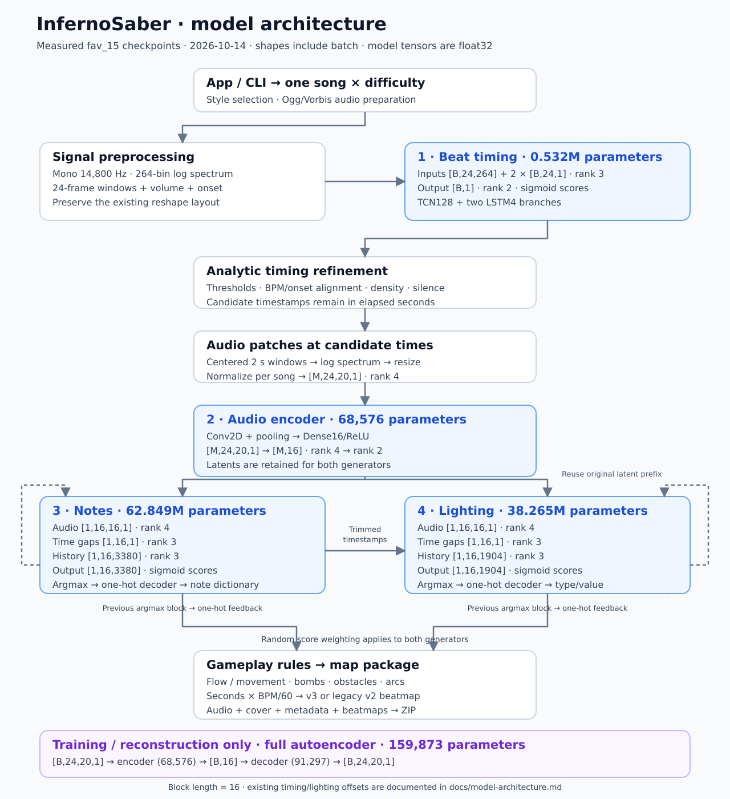
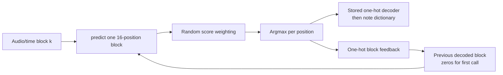
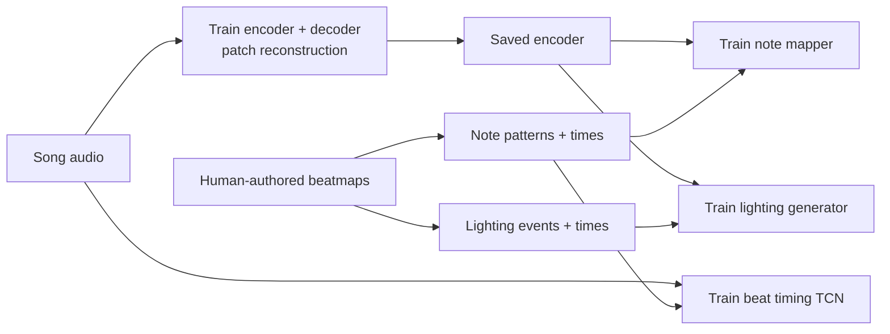

# Model architecture and call reference

InfernoSaber generates a beatmap with **four learned stages, in this order**:
beat timing → audio encoding → note patterns → lighting. Rules refine the timing
and gameplay between these stages. The full audio autoencoder is a fifth saved
model used for training and reconstruction evaluation; generation calls only its
encoder.

This reference describes the current source and the locally available `fav_15`
checkpoints, inspected on **2026-10-14**. Shapes and parameter counts below were
checked against loaded checkpoints, rather than inferred from filenames. Other
mapping styles can have different vocabularies and model sizes.



[Open the drawing](assets/model-architecture.svg) ·
[Measured model inventory](assets/model-inventory.json) ·
[Runtime setup](development.md) · [GPU profile](gpu-execution.md) ·
[Domain vocabulary](../CONTEXT.md)

## Reading the contracts

- Shapes include the batch axis. **Tensor rank** is the number of axes: `[B,16]`
  has rank 2. `B` is a batch size, and `None` in the inventory means a variable
  batch dimension.
- `T` is the reconciled audio-feature frame count; `N = T − 24` is the beat
  predictor's window count. `M` is the valid candidate-timestamp count after
  timing refinement and rejection of incomplete audio patches.
- `L = 16` is the sequence block length. `C_notes = 3380` and `C_events = 1904`
  are the **measured `fav_15` vocabulary sizes**. They come from separate stored
  one-hot encoders.
- Model inputs, weights, and outputs are **float32**. Host spectrogram arrays are
  float32; volume/onset windows, inference time deltas, and initial class history
  are usually float64 NumPy arrays, which Keras casts at the input boundary.
  Decoded classes and generated one-hot history are categorical data.
- All model time features and intermediate timestamps use **elapsed seconds**.
  Beatmap writers convert seconds to serialized beat times using `seconds × BPM/60`.
- **Order** means execution order. **Size rank** below ranks parameter count,
  largest first. No model-quality leaderboard or accuracy ranking has been
  established. Beat Saber `_difficultyRank` is a separate metadata field.

## Checkpoint inventory and model size

MiB means `bytes / 1,048,576`. Weight size is the float32 model-weight payload,
excluding optimizer state, tensors, activations, runtime libraries, and device
allocator overhead. It is **not a process RAM or VRAM estimate**. All measured
parameters in these five checkpoints are trainable.

| Order / usage | Model | Parameters | Size rank | Weights, MiB | H5 file, MiB | Exact H5 bytes |
| --- | --- | ---: | ---: | ---: | ---: | ---: |
| 1 / generation | Beat timing | 531,777 | 3 | 2.03 | 6.23 | 6,534,024 |
| 2 / generation | Audio encoder | 68,576 | 5 | 0.26 | 1.54 | 1,611,512 |
| 3 / generation | Note mapper | 62,848,896 | 1 | 239.75 | 719.32 | 754,264,800 |
| 4 / generation | Lighting generator | 38,264,640 | 2 | 145.97 | 437.98 | 459,253,728 |
| Training/evaluation | Full audio autoencoder | 159,873 | 4 | 0.61 | 1.89 | 1,986,280 |

The four inference models total **101,713,889 parameters**. The full autoencoder
contains the encoder again; it is not another required inference stage. The five
H5 files plus three class artifacts occupy **1,223,812,386 bytes** (about 1.224 GB).
The large H5 files contain optimizer state: for example, the note mapper has
251,395,584 bytes of model-weight datasets and 502,791,176 bytes of optimizer
datasets. This explains why download size greatly exceeds inference weight size.
The encoder H5 also carries optimizer state from its training context.

| Role | Checkpoint filename / class artifact | Purpose |
| --- | --- | --- |
| Timing | `tf_beat_gen_2_12_5_5__22_13.h5` | Detect candidate note times |
| Encoder | `tf_model_enc_16bneck_5_5__22_3.h5` | Compress each candidate's audio patch to 16 features |
| Notes | `tf_model_mapper_2-12_5_5__22_6.h5` | Select simultaneous note/bomb patterns |
| Lighting | `tf_event_gen_2_12_5_5__22_18.h5` | Select lighting event type/value pairs |
| Autoencoder | `tf_model_autoenc_16bneck_5_5__22_3.h5` | Reconstruct audio spectrogram patches |
| Note dictionary | `notes_class_dict.pkl` — 3,428 entries; 42,506 bytes | Note class ID → encoded gameplay pattern |
| Note categories | `onehot_encoder_beats.pkl` — 3,380 categories; 27,590 bytes | Model output column ↔ note dictionary ID |
| Event categories | `onehot_encoder_events.pkl` — 1,904 categories; 91,946 bytes | Model output column ↔ `"type;value"` string |

The note dictionary has more entries than the trained note vocabulary. An argmax
column must pass through the stored one-hot encoder's `inverse_transform()` before
indexing the dictionary. Column indices and dictionary IDs are not interchangeable.
Checkpoint SHA-256 values, exact shapes/dtypes, layer counts, and H5 dataset sizes
are recorded in the [inventory](assets/model-inventory.json).

## Entry points, selection, and call frequency

The Gradio callback [`run_process()`](../main_app.py#L278) selects a style, resolves
its model folder, downloads the bundle if needed, and starts
[`main_multi_par()`](../main_multi.py#L99). A worker calls
[`gen_beats.main()`](../map_creation/gen_beats.py#L64) once per song/difficulty
combination. [`main.main()`](../main.py#L18) is the single-run entry point.

The model directory is `paths.dir_path + "model/<lowercase-style>/"`, or
`model/general_new/` for an empty selection. Prefixes in
[`config.py`](../tools/config/config.py#L188) select each H5 role. The
[`resolver`](../tools/config/mapper_selection.py#L29) returns the first matching
directory entry; it does not select the newest checkpoint or validate tensor
compatibility. Keep a matching model/class-artifact bundle and one checkpoint per
role in the selected folder. The downloader uses `BierHerr/InfernoSaber` with the
selected style as its revision; its existing “already set up” test is a file-count
check, not a checksum check.

| Generation stage | Load / call site | Calls per song/difficulty |
| --- | --- | --- |
| Beat timing | [`gen_beats.py:140–144`](../map_creation/gen_beats.py#L140), `load_model(..., custom_objects={'TCN': TCN})`, then `predict([song, volume, onset])` | One load and one batched `predict()` |
| Audio encoding | [`gen_beats.py:235–238`](../map_creation/gen_beats.py#L235), `load_model(...)`, then `predict(song_ar[0])` | One load and one batched `predict()` |
| Note patterns | [`gen_beats.py:240–243`](../map_creation/gen_beats.py#L240) → [`generate()`](../lighting_prediction/generate_lighting.py#L29) → [`predict()`](../lighting_prediction/generate_lighting.py#L97) | One load; `floor(M/16) − 1` sequential `predict()` calls |
| Lighting | [`gen_beats.py:259–263`](../map_creation/gen_beats.py#L259) → the same `generate()` / `predict()` | One load; `floor(K_notes/16) − 1` sequential `predict()` calls |

`predict()` can internally split its batch; the table counts Python-level calls.
Each mapper/lighting call processes one 16-position block. There is no shared
model cache across song/difficulty jobs. The code clears Keras sessions between
the timing stage, encoder/mapper stages, and lighting stage; encoded NumPy audio
features survive for reuse by lighting.

Block-count formulas assume enough candidates for a successful run. Generation
rejects fewer than `3 × lstm_len = 48` candidates before its later filling,
silence filtering, and patch-boundary rejection; those later operations can
still change the available count. The sequence helper drops incomplete tails
rather than padding them.

Normal generation always calls lighting (`if True` in `gen_beats.py`).
`debug_beats=True` returns after timing refinement and calls only the beat model.
The optional second Expert beatmap reuses neural predictions with different
gameplay filtering. Separate difficulty jobs from the app rerun all four stages.
The v3 and v2 writers share the same learned pipeline.

## 1. Beat timing model

**Usage:** propose candidate gameplay timestamps from a continuous song analysis.
The audio encoder is not an input to this stage.

| Argument, in positional order | Input shape | Rank | Meaning |
| --- | --- | ---: | --- |
| `input_song_img` | `[B,24,264]` | 3 | Repacked log-spectrogram windows |
| `input_beat_prop` | `[B,24,1]` | 3 | Normalized spectral-bin sum (“volume”) |
| `input_onset_detection` | `[B,24,1]` | 3 | Normalized positive spectral flux |
| Output | `[B,1]` | 2 | One sigmoid beat score per window |

Necessary preprocessing, implemented in
[`find_beats.py`](../beat_prediction/find_beats.py#L11),
[`beat_prop.py`](../beat_prediction/beat_prop.py#L24), and
[`beat_to_lstm.py`](../beat_prediction/beat_to_lstm.py#L9):

1. The outer song check converts supported audio to Ogg/Vorbis `.egg`, optionally
   normalizes volume, and retains song metadata. This can modify files in the
   input folder; see [`check_music_files()`](../bs_shift/export_map.py#L34).
2. Aubio decodes mono at **14,800 Hz**. A Hann log-power spectrogram uses a
   **35.608 ms** window and **1 ms overlap**: 527 samples/window, 15 samples
   overlap, 512-sample stride, and 264 frequency bins. The helper's `step_size`
   argument supplies SciPy `noverlap`, not the hop size.
3. Aubio pitch and an amplitude summary establish a companion feature/time grid.
   Spectrogram/pitch lengths are reconciled and the spectrogram is resized to the
   pitch count. Pitch values themselves are not neural-model input arguments.
4. Sum frequency bins for the volume feature. Sum positive differences between
   successive spectra for onset, with an initial zero. Min/max normalize both
   per song.
5. Extract overlapping 24-frame spectral windows. The implementation selects
   `[264,24]` windows and **reshapes their flat data to `[24,264]`**, rather than
   transposing axes. This memory layout is part of the pretrained input contract.
   `range(T − 24)` produces `N = T − 24` windows. Min/max normalization of spectral
   windows covers the entire song's window tensor.

**Network:** the song branch is a causal TCN with 128 filters, kernel size 2,
dilations `[1,2,4,8,16,32]`, one stack, skip connections, ReLU, and no dropout or
normalization. Volume and onset each enter a 4-unit LSTM. Concatenate the
128+4+4 features → Dense256/ReLU → Dense128/ReLU → Dense1/sigmoid.
See [`create_music_model('tcn')`](../training/tensorflow_models.py#L112).

**Output processing:** difficulty and song-region thresholds convert scores to
binary decisions. Minimum-spacing checks remove close decisions. Prediction
index `i` becomes `i / config.beat_spacing` seconds; the current spacing is
`5587/196 ≈ 28.5051` steps/second. Decisions at or before `config.window = 2`
seconds are excluded. Rules then fill gaps, align to detected BPM, match audio
onsets, add start/end candidates, apply target density, and remove silent parts.
Onset matching separately loads audio at 44,100 Hz with hop length 512. These
operations are analytic processing, not additional learned models.

**Training/inference caveat:** the current
[`beat training code`](../beat_prediction/ai_beat_gen.py#L93) trims the song to a
multiple of 24 retained frames, reshapes the entire frequency-major spectrogram
directly into `[-1,24,264]`, and selects labels at retained-frame positions
23, 47, 71, and so on. It does not use inference's overlapping-window extraction;
the sliding training call is commented out. The two paths therefore differ in
sampling and feature packing. This is a source comparison, not verified training
provenance for the saved checkpoint. Inference timestamps prediction `i` directly
at `i / beat_spacing`, with no window-end offset. The configured 28.5051
steps/second also differs from the audio stride rate `14800/512 = 28.90625`
frames/second. Subsequent timing rules adjust candidates; raw model indices must
not be described as exact audio-frame timestamps.

## 2. Audio encoder

**Usage:** summarize audio around the refined candidate timestamps, once, for
both the note and lighting generators.

| Argument | Shape | Rank | Format |
| --- | --- | ---: | --- |
| Spectrogram patches | `[M,24,20,1]` | 4 | Float32, channels last; frequency × time × channel |
| Output latents | `[M,16]` | 2 | Float32 nonnegative ReLU features, not probabilities |

Necessary preprocessing in
[`music_processing.py`](../preprocessing/music_processing.py#L16):

1. Decode mono at 14,800 Hz and extract **2-second windows centered on each
   elapsed-second candidate timestamp**. Round timestamps to sample positions.
   Reject a window if its start is negative or its end reaches/passes the loaded
   sample-array length; delete the corresponding candidate timestamp.
2. Take absolute waveform values and multiply by 100. Compute a Hann
   log-power spectrogram with **100 ms** windows and **1 ms overlap**
   (`nperseg=1480`, `noverlap=15`), producing 20 time slices per 2-second patch.
3. Subtract each patch's minimum, resize the frequency axis to **24 bins** with
   Pillow, and transpose to frequency × time. Min/max normalize the song's
   complete patch array, then append a singleton channel axis.

The 264-bin timing spectrogram and 24×20 encoder patch are distinct
representations. There is no mel-spectrogram, tokenization, or external embedding
service in either path. The shared min/max helper has no constant-array guard;
these contracts describe nonconstant, valid audio.

**Network and intermediate shapes**, excluding the batch axis:

```text
24×20×1 → Conv2D32, 3×3 same/ReLU → 24×20×32
         → MaxPool2, same          → 12×10×32
         → Conv2D16, 3×3 same/ReLU → 12×10×16
         → MaxPool2, same          → 6×5×16
         → Flatten480 → Dropout0.05 → Dense128/ReLU → Dense16/ReLU
```

The encoder has **68,576 parameters**. Dropout is inactive during inference.
Source: [`create_keras_model('enc1')`](../training/tensorflow_models.py#L61).

## 3. Note-pattern mapper

**Usage:** choose a complete simultaneous note/bomb pattern for each generated
timestamp, conditioned on audio, time gaps, and the preceding predicted block.

| Argument, in positional order | Shape per call | Rank | Meaning |
| --- | --- | ---: | --- |
| `input_song_enc` | `[1,16,16,1]` | 4 | A block of 16 audio latents, each 16 features |
| `input_time_lstm` | `[1,16,1]` | 3 | Elapsed-second gaps; first gap is the fixed value `1` |
| `input_class_lstm` | `[1,16,3380]` | 3 | Previous block's one-hot note classes; initially all zeros |
| Output | `[1,16,3380]` | 3 | Sigmoid score grid for 16 future pattern positions |

**Network:** audio → Conv2D32, valid 3×3/ReLU → Flatten6272. Time gaps →
LSTM32 with sequences; class history → LSTM64 with sequences. Concatenate the
recurrent branches → LSTM64 with a final-vector output. Concatenate with audio
(6336 features) → Dense1024/ReLU → Dropout0.05 → Dense54080/sigmoid →
reshape to 16×3380. The final dense layer alone has **55,432,000 parameters**.
Source: [`create_keras_model('lstm_half')`](../training/tensorflow_models.py#L35).

**Block convention:**
[`lstm_shift_events_half()`](../lighting_prediction/train_lighting.py#L29)
trims `M mod 16` rows, forms complete blocks, and drops the last audio/time input
block. Audio/time block `k` conditions the categorical output for block `k+1`.
There are `Q = floor(M/16) − 1` model calls and `K_notes = 16Q` decoded positions.
Generation discards the first 16 candidate timestamps and truncates the rest to
`K_notes`. For example, 100 valid candidates yield five calls, 80 pattern
positions, timestamps 16–95, and a four-position tail discard.



The model predicts all 16 positions together. It is autoregressive **between
blocks**, with discrete one-hot feedback, rather than one model call per note.
The output head uses sigmoid; its class scores do not sum to one. Before argmax,
[`apply_random_mapper()`](../lighting_prediction/generate_lighting.py#L120)
rescales scores and applies a random class-region weighting. Defaults are factor
`0.3` and a new weighting center every three blocks; factor `0` disables it.
The same weighting is also applied to lighting.

Output decoding is argmax → integer one-hot grid → flatten to `[K_notes,3380]`
→ stored one-hot encoder `inverse_transform()` → `[K_notes,1]` dictionary IDs.
[`decode_beats()`](../map_creation/map_creator.py#L106) indexes the dictionary and
decodes digit strings into repeating `[x,y,type,cut_direction]` groups. For
example, `"0104"` means one object at `x=0`, `y=1`, type `0`, direction `4`.
A class can contain several simultaneous objects; types `0/1` are saber colors
and type `3` is a bomb. These outputs are gameplay patterns, not individual
continuous coordinates.

## 4. Lighting generator

**Usage:** generate basic lighting event type/value pairs on the supplied
gameplay-timing sequence. The stored one-hot encoder is independent of the note
vocabulary.

| Argument, in positional order | Shape per call | Rank | Meaning |
| --- | --- | ---: | --- |
| `input_song_enc` | `[1,16,16,1]` | 4 | Reused audio-latent blocks |
| `input_time_lstm` | `[1,16,1]` | 3 | Gaps from the mapper-trimmed timestamps |
| `input_class_lstm` | `[1,16,1904]` | 3 | Previous one-hot lighting block; initially zeros |
| Output | `[1,16,1904]` | 3 | Sigmoid scores for 16 positions × 1,904 lighting categories |

The network has the same topology as the note mapper, with a smaller categorical
branch and a Dense30464/sigmoid output head. Its final dense layer has
**31,225,600 parameters**; the whole model has **38,264,640**. Source:
[`create_tf_model('lstm_half')`](../lighting_prediction/tf_lighting.py#L49).

Shared [`generate()`](../lighting_prediction/generate_lighting.py#L29) performs
the block loop, random score weighting, argmax, feedback, and one-hot decoding.
Event categories are strings such as `"0;1"`; they decode into numeric
`[event_type,event_value]` pairs in a float64 array `[K_events,2]`, with
`K_events = 16 × (floor(K_notes/16) − 1)` under the default sequence lengths.
[`events_to_json()`](../map_creation/map_creator.py#L169) pairs events with the
prefix of the supplied beatmap times and writes `b`, `et`, `i`, and fixed `f=1.0`.

**Existing alignment caveat:** lighting receives the original encoder output
alongside timestamps that already lost the mapper's first 16 positions. The
shared generator truncates the latent **prefix** to the new length; it does not
remove the corresponding first 16 latent rows. Its next-block predictions also
use the beginning of the supplied timestamp array during serialization, without
another leading timestamp shift. The drawing shows reuse of the latents, not a
guarantee of timestamp alignment. Changing this behavior requires a separate
generation-semantics decision.

## Gameplay processing and export

Decoded note patterns pass through rule-based flow, speed/movement, first-note,
double-note, break, dot-note, and bomb processing. Obstacles and arcs are generated
analytically from notes and timing; there are **no separate obstacle or arc
models**. These rules can remove or add objects, so model class-position counts
are not final note counts. See
[`create_map()`](../map_creation/map_creator.py#L17) and
[`sanity_check_notes()`](../map_creation/sanity_check.py#L16).

The current v3 writer emits v3.2.0 beatmaps and v2.0.0 level metadata. The legacy
v2 path uses [`map_creator_deprecated.py`](../map_creation/map_creator_deprecated.py).
Both package audio, cover, metadata, and beatmaps; ZIP creation and optional
Beat Saber-library copy occur outside the learned pipeline.

The app's BPS difficulty setting becomes `config.max_speed = BPS × 4`. It affects
timing thresholds, target density, and gameplay rules, rather than entering the
neural models as an explicit difficulty tensor. During multidifficulty package
assembly, ordered slots receive Easy/Normal/Hard/Expert/ExpertPlus and metadata
ranks 1/3/5/7/9. Those ranks are independent of parameter size and numeric BPS;
one BPS-5 slot can therefore be labeled Easy.

## Full autoencoder and training relationships

The full autoencoder is `encoder(patch) → decoder(latent)`, trained to reconstruct
the input patch. Its input and output are both float32 `[B,24,20,1]`, rank 4.
Its separate decoder has **91,297 parameters**:

```text
16 → Dense128/ReLU → Dense640/ReLU → reshape10×8×8
   → Conv2DTranspose32, kernel5/stride2/ReLU → 23×19×32
   → Conv2DTranspose1, kernel2/stride1/sigmoid → 24×20×1
```

The full **159,873-parameter** model includes the **68,576-parameter** encoder.
The training script saves both full autoencoder and encoder; there is no
standalone decoder checkpoint in this bundle. For autoencoder training, patches
are consecutive nonoverlapping 2-second windows. Mapper training uses patches
centered on note-pattern times; lighting training uses patches centered on
human lighting-event times. Inference lighting instead uses the generated
gameplay timings.



Current training defaults are batch size 128 throughout:

| Script / builder | Input → target | Loss / optimizer | Epochs / learning rate | Saved output |
| --- | --- | --- | --- | --- |
| [`train_autoenc_music.py`](../training/train_autoenc_music.py#L89), `enc1` + `dec1` | `[B,24,20,1]` → same patches | MSE / Adam | 50 / `3e-4` | Full autoencoder + encoder H5 |
| [`train_bs_automapper.py`](../training/train_bs_automapper.py#L89), `lstm_half` | Audio/time/class block `k` → note one-hot block `k+1` | Categorical crossentropy / Adam | 180 / `4e-4` | Mapper H5 + note artifacts |
| [`ai_beat_gen.py`](../beat_prediction/ai_beat_gen.py#L136), `tcn` | Spectral/volume/onset windows → binary last-frame label `[B]` | Binary crossentropy / Adam, inverse-frequency class weights | 80 / `5e-4` | Beat H5 |
| [`train_lighting.py`](../lighting_prediction/train_lighting.py#L178), `lstm_half` | Audio/time/class block `k` → event one-hot block `k+1` | Binary crossentropy / Adam | 180 / `1e-3` | Lighting H5 + event encoder |

Training uses ground-truth previous class blocks; inference feeds previous
predictions back. Beat training resamples note times to the nearest feature-grid
position and randomly removes 60% of nonbeat frames by default before forming
24-step target blocks and directly repacking the spectral array. Its feature
packing differs from inference, as detailed in the beat-model caveat above.
Mapper/light training concatenates songs before forming shifted blocks, so blocks
can cross song boundaries. Note grouping treats times within `0.01` seconds as
synchronized, then builds a dictionary of whole patterns.

Autoencoder training reserves the first ten patches for testing and splits the
remaining data into training/validation portions. Mapper training reserves the
last ten blocks. Beat and lighting scripts display predictions on training
subsets; those displays are not held-out quality measurements. Current accuracy
metrics do not establish an overall mapping-quality rank.

## Remaining model calls and historical builders

This table accounts for neural calls outside the production path. The `.fit()`
calls on `OneHotEncoder` build categorical lookup tables and are not neural
training.

| Caller | Model calls / purpose |
| --- | --- |
| [`training/helpers.py:19`](../training/helpers.py#L19), `ai_encode_song()` | Load encoder and `predict()` patches for mapper/light training and mapper evaluation |
| [`training/helpers.py:65`](../training/helpers.py#L65), `load_keras_model()` | Shared H5 loader for generator, training, and evaluation; exact filename, or newest H5 by creation time when passed literal `"old"` |
| [`training/train_autoenc_music.py:89`](../training/train_autoenc_music.py#L89) | Load/build full autoencoder; symbolic encoder/decoder calls construct its graph; `fit()`, `evaluate()`, save full model and encoder |
| [`training/plot_model.py:44`](../training/plot_model.py#L44) | `auto_model.predict()` and `enc_model.predict()` for reconstruction/latent plots |
| [`training/eval_autoenc_music.py:32`](../training/eval_autoenc_music.py#L32) | Load full autoencoder and encoder; reconstruction `evaluate()` and plot helper predictions |
| [`training/train_bs_automapper.py:89`](../training/train_bs_automapper.py#L89) | Load/build mapper, `fit()`, `evaluate()`/`predict()` on test and training subsets, save |
| [`training/eval_bs_automapper.py:79`](../training/eval_bs_automapper.py#L79) | Load mapper, then `evaluate()`/`predict()` on test and training subsets; historical `lstm1` fallback |
| [`beat_prediction/ai_beat_gen.py:136`](../beat_prediction/ai_beat_gen.py#L136) | Build beat model, `fit()`, save, training-subset `predict()` |
| [`lighting_prediction/train_lighting.py:178`](../lighting_prediction/train_lighting.py#L178) | Build lighting model, `fit()`, save, training-subset `predict()`; its `evaluate()` line is commented out |
| [`evaluation/evaluate_beat_algorithms.py`](../evaluation/evaluate_beat_algorithms.py), `run_benchmark()` | Indirect beat-model call through `gen_beats.main(..., debug_beats=True)`; scores processed timing proposals against human note onsets, before downstream mapping |
| [`tests/test_keras_models.py:17`](../tests/test_keras_models.py#L17) | Build/save/load a tiny test-only TCN; direct original/restored forward calls check H5 compatibility |

Historical or unused builder branches are separate from the loaded `fav_15`
architectures:

| Builder | Contract and status |
| --- | --- |
| [`create_keras_model('lstm1')`](../training/tensorflow_models.py#L13) | Single audio vector + sliding time/class history → single softmax class vector `[B,C]`; only current caller is the mapper evaluation fallback |
| [`create_tf_model('lstm_light')`](../lighting_prediction/tf_lighting.py#L10) | Audio vector + time history → softmax event vector `[B,C]`; no active callers |
| [`create_tf_model('lstm_full')`](../lighting_prediction/tf_lighting.py#L27) | Audio vector + time/class history → softmax event vector `[B,C]`; no active callers |
| [`create_post_model('lstm1')`](../training/tensorflow_models.py#L174) | `[B,L,5]` → LSTM256 → LSTM128 → Dense512 → Dropout → Dense256 → Dense`dim_out`/ReLU, default `[B,2]`; no callers or associated local checkpoint |

The old beat LSTM architecture is commented out. Unused builders have no measured
checkpoint size or established quality rank in this reference.

## Compatibility and verification

Use `tensorflow.keras` consistently. The CPU profile uses TensorFlow 2.15.1 /
Keras 2.15; the GPU profile uses TensorFlow 2.21 / legacy tf-keras 2.21 selected
with `TF_USE_LEGACY_KERAS=1`. The beat H5 needs `custom_objects={'TCN': TCN}`.
Production loads compiled H5 models; the inspection recorded here loaded with
`compile=False` to measure inference contracts without restoring optimizers.
See [GPU execution](gpu-execution.md) for verified device behavior.

Verification for this document:

- All five local H5 checkpoints loaded in the retained CPU environment
  (Python 3.10.19, TensorFlow 2.15.1), and batch-one zero-input forward passes
  produced finite float32 outputs with the recorded shapes. Parameter counts,
  layer structure, H5 datasets, file sizes, and SHA-256 values were inspected.
- Read-only preprocessing of the local `BWB - No Sleep.egg` sample produced
  a `[264,3887]` spectrogram and timing inputs `[3863,24,264]`,
  `[3863,24,1]`, `[3863,24,1]`. Patches at 5, 10, and 15 seconds produced
  `[3,24,20,1]`. Details are in the measured inventory.
- The existing CPU/GPU real-song package-generation results are recorded in
  [baseline.md](baseline.md). This documentation task did not rerun generation,
  train models, or evaluate musical quality. Native Windows and the full training
  workflow remain unverified.

The training call map is source-inspected, not a guarantee that every historical
script currently runs. Training data preparation rewrites class artifacts:
note preprocessing replaces the note dictionary/encoder, lighting replaces its
encoder, and beat training's `load_beat_data()` also rewrites the note dictionary.
Standalone mapper evaluation invokes the same mutating preprocessing. Use a
separate training model folder when exploring these scripts. Existing resume
paths also need review: autoencoder resume does not reconstruct the separately
saved `encoder` variable, and mapper evaluation's old `lstm1` fallback does not
match current block-shaped inputs. These behaviors were documented without
changing architecture or generation semantics.
