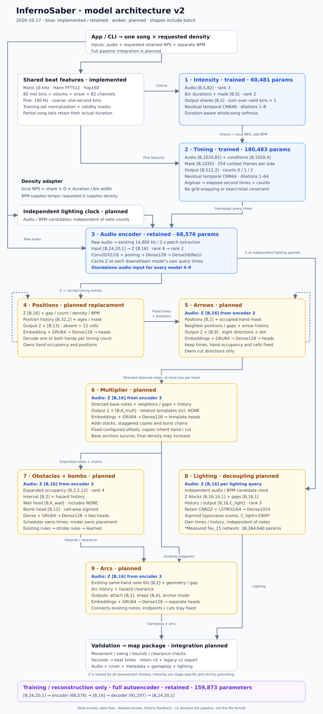

# Model architecture v2

Target design, agreed **2026-10-17**, implemented for training and application generation.
As of **2026-10-18**, all eight model stages have completed training runs; the
audio encoder is retained. Completed training is separate from positive-case
quality and playable generation. See [v2 commands and review boundaries](pipeline-v2.md)
and the [completed-run evaluation](baseline.md#v2-completed-runs-and-inference-bundle-2026-10-18).
The drawing's amber colors describe the original implementation milestone.
The trained joint position/direction model is documented in
[the implemented beat framework](model-beat-architecture.md); v2 separates it
into **positions → arrows**. The production generator connects these stages through
retained legacy cleanup; the concept command retains its isolated review boundaries.

[Open the drawing](assets/model-architecture-v2.svg) ·
[Implemented three-model architecture](model-beat-architecture.md) ·
[Legacy architecture and measured checkpoints](model-architecture_old.md) ·
[Training commands](beat-model-training.md) · [Domain vocabulary](../CONTEXT.md)

## Reading the contracts

- Shapes include batch `B`; rank is the number of axes. `S` = one-second bins,
  `H = 32` = history length, `L = 16` = legacy lighting block length.
  `K_mult` and `K_wall` are bounded template counts, including NONE;
  vocabularies are fitted on training recordings only and frozen for later stages.
- Features/probabilities are float32; categories are integers; padding masks are
  boolean. All times and gaps are **elapsed seconds**. Each stage uses aligned
  current audio, upstream outputs, and strictly preceding own-stage history.
- Requested density `D` means **retained colored notes/second**, before expansion.
  A red/blue pair counts as two. BPM is a separate input. Multiplier output can
  increase final density; neither density is an exact output-count guarantee.
- Training retains one note per hand after synchronization using
  `config.min_time_diff = 0.02 s`. Original notes, directions, timestamps, and
  source-to-retained relationships remain available as expansion targets.
- Downstream stages reuse the existing **16-float** encoder, not a 24-bit code.
  Its preprocessing remains separate from the implemented 16 kHz beat features.
  Network widths below describe the implemented models. Trained checkpoints
  have CPU comparisons; full composed gameplay quality remains unverified.

## 1. Intensity — implemented / trained

**I/O:** whole-song coarse audio `[B,S,82]`, durations and mask `[B,S]` →
shares `[B,S]`, normalized over valid bins. Each bin owns a fraction of retained notes.

**NN:** residual temporal CNN, 48 channels, two kernel-3 convolutions per block,
dilations 1/2/4/8 → log-density + log bin duration → masked whole-song softmax.
**60,481 parameters**; approximately 61 seconds of local context.

**Example:** a 100-second song, requested `D = 4`, and a one-second bin with
share `0.015` give `0.015 × 4 × 100 / 1 = 6` local notes/second. Generally,
`local_NPS[i] = share[i] × D × duration / bin_duration[i]`.

## 2. Timing — implemented / trained

**I/O:** fine audio `[B,1020,82]`, conditions `[B,1020,4]`, validity mask
`[B,1020]` → `[B,512,3]` probabilities for **0 / 1 / 2 retained notes** per frame.
Conditions are relative intensity, `D/10`, local NPS/10, and BPM/120.

**NN:** residual temporal CNN64, two kernel-3 convolutions per block, dilations
1–64 → crop 254 context frames per side → three-class softmax.
**180,483 parameters**; 509-frame receptive field. Audio is mono 16 kHz,
FFT512, hop160: 80 mel bins + volume + onset, at **100 frames/second**.

**Example:** probabilities `[0.05, 0.10, 0.85]` at frame 1000 produce
`(time=10.00 s, count=2)`. Timing chooses neither hands nor positions.
Frame argmax yields timestamps; final BPM alignment/grid snapping is separate.

## 3. Audio encoder / autoencoder — retained

**I/O:** centered two-second spectrogram `[B,24,20,1]` → latent `[B,16]`.
Keep the checkpoint's 14,800 Hz decoding and resized log-spectrum. The approved
normalization adaptation fits one min/max scale on a fixed half-second grid per
song and reuses it for every stage. Cache latents at gameplay, hazard, arc and
independent lighting query locations. The adapter pads edge patches while
retaining timestamps; the encoder weights remain unchanged.
Every model **4–9** receives its own snippet's **`Z [B,16]`** directly from this
standalone encoder, alongside its other inputs.

**NN:** Conv2D32 → pool → Conv2D16 → pool → Flatten480 → Dense128 → Dense16/ReLU.
Encoder **68,576 parameters**. The full reconstruction autoencoder adds
Dense128/640 and Conv2DTranspose32/1 to recover `[B,24,20,1]`:
**159,873 parameters** total; its decoder is training/evaluation only.

**Example:** the audio patch centered at 10.00 seconds becomes
`[0.12, 0.00, …, 0.43]`, a vector of 16 continuous features.

## 4. Positions — implemented / trained replacement

**I/O:** latent `[B,16]`, previous position IDs `[B,H,2]`, ages/mask,
and six conditions (gap, required count, then timing's four conditions) →
red and blue `[B,13]` softmax heads: **absent + 12 grid cells**, without directions.
Decode the best pair preserving count one or two; zero-count frames skip this model.

**NN:** latent → Dense64; position Embedding16 + history ages → masked
GRU64. Concatenate both branches with conditions → Dense128 → two Dense13 heads.

**Example:** `(10.00 s, count=2)` → red `(x=0,y=2)`, blue `(x=3,y=2)`.
Position ID is `1 + 4*y + x`; zero means absent. These have pending directions,
not forced dot labels. Movement constraints are an explicit implementation review
stop; the concept decoder preserves the timing count.
The former joint model's two Dense109 heads predict position **and** direction.
That checkpoint is excluded from the v2 inference bundle; the trained positions
model uses the separate 13-category heads above.

## 5. Arrows — implemented / trained

**I/O:** fixed current red/blue positions `[B,2]`, occupied-hand mask, neighboring
positions/gaps, audio **`Z [B,16]`**, density/BPM, and preceding arrow history → two `[B,9]`
softmax heads: **eight cut directions + dot**. Ignore heads for absent hands.

**NN:** position embeddings + audio Dense64 + masked history GRU64
→ Dense128 → separate red/blue Dense9 heads. Future positions may provide
lookahead because the position pass finishes first; future arrows are not inputs.

**Example:** red `(0,2)` and blue `(3,2)` at 10.00 seconds → red down, blue down.
Times, positions and count stay fixed. Swing feasibility is an explicit review
stop; bomb placement belongs to the hazards stage.

## 6. Multiplier — implemented / trained

**I/O:** directed retained notes, neighboring notes/gaps, audio **`Z [B,16]`** and expansion
history → per-hand `[B,K_mult]` softmax over **relative expansion templates**.
Templates cover NONE, simultaneous stacks, staggered copies and burst chains;
include relative geometry, copy/slice count and chain span where applicable.

**NN:** note/template embeddings + audio Dense64 + history GRU64
→ Dense128 → two template heads. Use bounded relative templates instead of a
vocabulary of complete two-hand maps. Added notes inherit the hand and cut
of their retained anchor; expansion follows that swing. Supervised expansion
uses same-event reductions and explicit chains. Normal notes beyond the existing
synchronization interval remain retained timing targets. Unsupported reductions
are preserved and masked rather than reassigned.

**Example:** red down at `(0,2), 10.00 s` → retain it and add `(0,1)` at
`10.00 + δt` seconds. `δt=0` makes a stack; positive configured `δt` makes
staggered copies. The expansion interval is distinct from the 20 ms preprocessing
merge threshold. Chain templates add a burst chain, not an arc. Preserve base
anchors and report retained notes, added notes, and chain slices separately.

## 7. Hazards: obstacles + bombs — implemented / trained combined model

**I/O:** neighboring expanded-note occupancy `[B,2,2,12]`, candidate interval
`[B,2]`, audio **`Z [B,16]`**, density/BPM and previous hazards → wall-template probabilities
`[B,K_wall]` (including NONE) and bomb-cell probabilities `[B,12]` (multi-label).
Use the complete expanded-note sequence for clearance checks, including chains.

**NN:** occupancy/audio Dense branches + hazard-history GRU64
→ Dense128 → wall softmax and bomb sigmoid heads. One object family owns all
avoidance objects; neither head changes colored notes or their arrows.

**Example:** an eligible 10.10–10.40 s interval → left-lane wall + no bombs;
another query can select a bomb at `(3,1)`. A deterministic scheduler supplies
wall bounds and bomb candidate times; heads select geometry/occupancy, not time.
The concept scheduler implements deterministic gap, strobe and bomb proposals.
Adapting the complete legacy obstacle/clearance rules remains a named review
stop. Human wall intervals and bomb times supplement positive training queries;
inference uses scheduler proposals only, with coverage reported separately.

## 8. Lighting events — retained topology, independent scheduling implemented

**I/O:** audio **`Z [B,16]` per lighting query**, stacked into `[B,L,16,1]`,
gaps `[B,L,1]`, lighting history `[B,L,C_light]`
→ `[B,L,C_light]` type/value scores. `L=16`; the measured legacy `fav_15` vocabulary
has `C_light=1904`. The new training-only vocabulary is frozen separately. Each
active class decodes to a lighting type/value pair; multiple classes may be
active at one query, and an all-zero target means no command.

**NN:** retain Conv2D32 audio + LSTM32 time / LSTM64 class history → LSTM64
→ Dense1024 → Dense(`L*C_light`)/sigmoid → reshape.
The measured legacy model has **38,264,640 parameters**. The adapted model size
depends on the newly fitted class count. The evaluated v2 checkpoint has
**2,048 classes and 40,663,104 parameters**.

**Example:** an independent audio/BPM candidate at 10.25 seconds → `(type=0,
value=1)`, even if there is no note there. The lighting scheduler supplies its
own timestamps, patches, masks and history. Align current audio/time blocks
with their targets and retain tails; do not inherit the legacy note-count
trimming or next-block offset. The independent multi-label model has now been
trained. The old lighting checkpoint remains incompatible with these targets.

## 9. Arcs — implemented / trained, positive-case quality unverified

**I/O:** existing same-hand endpoint pairs `[B,2]` (note IDs), endpoint
positions/directions, gap, audio **`Z [B,16]`** and preceding arcs → attachment probabilities
`[B,2]` (no/yes), shape controls `[B,A]`, and an anchor-mode category.
`A=2` covers the existing writer's `mu` and `tmu` controls, initially bounded to
`[0,2]`; anchor modes are 0/1/2. Unsupported controls are preserved and masked.

**NN:** endpoint position/direction embeddings + audio Dense64 + history GRU64
→ Dense128 → attachment softmax, bounded shape head and anchor-mode softmax.

**Example:** connect red note 17 at 10.00 seconds to red note 23 at 10.50 seconds,
with selected curve handles. Use expanded notes and hazard clearance; keep
endpoint positions/times fixed and add no cuts. Early-stop variants that need
new endpoints remain an extension. Burst chains belong to the multiplier.

The completed run's validation split has no positive arc attachments, although
training has positive examples. Its near-zero validation loss measures negative
decisions and cannot establish attachment, handle or anchor quality.

## Composition boundary

**Intensity → timing → positions → arrows → multiplier → hazards → arcs**;
lighting runs on its independent timeline. The shared encoder supplies downstream
audio. Each stage owns its output objects/attributes and passes upstream data on.
The production order is **intensity/timing → timing cleanup → positions/arrows →
legacy note cleanup → multiplier → hazards → arcs → export**. Lighting keeps its
own timeline. Legacy movement/direction changes finish before stable note IDs and
learned expansions. Training reduction chooses one representative per hand;
heuristic extra notes remain separate. Downstream clearance rejects additions
without moving those anchors. Export converts seconds to beats once, writing
3.2.0 by default or the existing 2.0.0 legacy option. Native chains belong to the
multiplier; v2 export keeps their colored heads and reports omitted bodies/arcs.

The concept command still has explicit review stops. Successful production
serialization establishes package validity, not in-game playability. V2 names the
pipeline design, not Beat Saber's file-format version. See
[generation details](generation-v2.md) for settings, lifecycle and limitations.

The measured intensity/timing/joint-notes implementation, training run
`20261017-151437`, verification evidence and pending quality checks remain in
[model-beat-architecture.md](model-beat-architecture.md). Completed downstream
runs, independent CPU comparisons and the `v2_expert` inference bundle are
documented in [the v2 handoff](pipeline-v2.md). Gameplay quality remains unverified.
