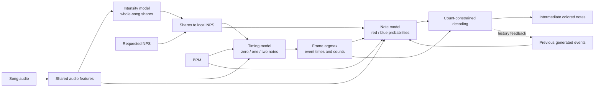

# Intensity, timing, and note model architecture

This reference describes the three-model framework in
[`training/beat_models/`](../training/beat_models/), checked against the source
and completed training run **`20261017-151437`** on **2026-10-17**.

The learned stages are **audio → intensity distribution → difficulty-conditioned
timing → per-hand note patterns**. They produce intermediate predictions. The
existing application generator remains separate; integration, final alignment,
grid snapping, map export, lighting, obstacles/bombs, and a future multiplier
are outside this architecture milestone.

The subsequent [v2 concept framework](pipeline-v2.md) now implements separate
positions, arrows, multiplier, hazards, lighting and arcs stages with explicit
review stops. It reuses this trained intensity/timing pair; the joint `notes`
checkpoint described here remains a separate earlier model.

The previous generator, autoencoder, H5 checkpoints, learned pattern
dictionaries, and lighting architecture are documented in the preserved
[legacy reference](model-architecture_old.md). Those checkpoints are incompatible
with these new input/output contracts.

[Preparation and training commands](beat-model-training.md) ·
[Domain vocabulary](../CONTEXT.md) · [Recorded checks](baseline.md) ·
[CPU environment](development.md) · [GPU environment](gpu-execution.md)

## Pipeline and responsibilities



Intensity allocates relative note density over the song. Timing selects when
notes occur and whether an onset contains one or two colored notes. Notes
selects the occupied hand, position, and cut direction, respecting that count.
The models are trained independently; the discrete timing/decoding stages do
not form an end-to-end differentiable training graph.

Difficulty is **retained colored notes per second over the decoded song**. A
simultaneous red/blue pair counts as two notes and one onset. BPM is a separate
tempo input; multiplying intensity by BPM is not the density conversion.
These models do not estimate BPM themselves.

## Tensor conventions and model inventory

Shapes include the batch axis `B`. `F` is the number of valid fine audio frames,
`S` the number of one-second intensity bins, and `E` the number of retained note
events. Values below describe the architecture used by the recorded run;
dimensions and widths are configurable where noted.

- Audio features, conditioning, durations, model weights, and probabilities use
  float32. Stored exact source/event times use float64 elapsed seconds.
- Category IDs and frame indices are integers; validity masks are boolean.
- There are 100 fine frames/second. Frame `j` is centered at `j × 160/16000`
  seconds. Output uses this sample-derived timeline rather than legacy
  `config.beat_spacing` or a musical beat grid.
- Intensity normalizes across the whole song; timing normalizes across three
  count classes at each frame; each note head normalizes across 109 categories.

| Order | Model | Parameters | Main output |
| --- | --- | ---: | --- |
| 1 | Intensity | 60,481 | `[B,S]` whole-song note shares |
| 2 | Timing | 180,483 | `[B,512,3]` count probabilities per context window |
| 3 | Notes | 173,450 | Red and blue `[B,109]` category probabilities |
| | Total | **414,414** | |

Each builder enforces fewer than one million parameters. The combined float32
weight payload is 1,657,656 bytes (about 1.58 MiB); this excludes optimizer state,
activations, library/device allocations, and file metadata, and is not a VRAM
estimate. Source: [`models.py`](../training/beat_models/models.py).

## Shared audio and supervised targets

### Audio features

[`features.py`](../training/beat_models/features.py) supplies the same extractor
for training and inference:

1. Decode mono audio at **16,000 Hz** with `aubio.source`; retain only the
   decoder's reported samples in the final block. Duration is the resulting
   sample count divided by sample rate.
2. Use a **512-sample Hann FFT**, **160-sample hop**, and **80 mel-power bins**.
   Waveform padding is explicit and constant-zero, with centered analysis.
   Retain all frame centers before the decoded duration, including partial tails.
3. Volume is the sum of mel power; onset strength is the sum of positive
   frame-to-frame mel-power differences. Append these to the 80 mel channels,
   then apply `log1p`, giving fine features `[F,82]`.
4. For coarse features `[S,82]`, average the linear-power features within each
   second **before** `log1p`. Keep the final bin's actual duration rather than
   treating it as a full second.
5. Fit separate fine/coarse channel means and scales on training songs only.
   Apply the saved statistics unchanged to validation, test, and inference.

Intensity uses coarse features. Timing uses fine features. The note CNN takes
only the 80 mel channels from the shared fine features, with its own audio
validity mask; its patch excludes the extra volume/onset channels.

### Source notes and synchronization

[`data.py`](../training/beat_models/data.py) supports intact packages with v2 Info
and ordinary v2/v3 colored notes, or an explicitly selected prepared-triple
adapter. Prepared inputs record that original difficulty/characteristic
provenance may be unverified. BPM must be positive and constant, with zero
offset/shuffle. Unsupported versions, tempo changes, direction-angle offsets,
geometry, missing files, and decoding failures are skipped individually.
The [training guide](beat-model-training.md) documents filename compatibility
and the remaining import limits.

Bombs are excluded. Sort onsets chronologically and synchronize them with the
existing `config.min_time_diff`, currently **0.02 seconds**. Each event is
anchored at its earliest time and includes source onsets up to that anchor plus
the interval, inclusive. Grouping does not chain through the last merged note.
This merge is silent, including for microsecond source-time differences.

Within each synchronized event, keep at most one note per hand. For a common
non-dot cut direction, keep the first position along that swing; a downward
cut therefore keeps the highest note. Dots, mixed directions, and projection
ties use source-order fallbacks. Preserve complete colored-note JSON records,
numeric source records and exact timestamps, `retained_indices`, and
`original_event_indices` mapping every source note to its synchronized event.
These retain the information needed by the future multiplier.

Timing labels use the nearest valid fine frame, with half-frame ties assigned
later and final-tail labels clamped to the last valid frame. At the default
synchronization interval, near-time source collisions have already merged.
If a smaller interval leaves distinct events in one frame, preparation rejects
that map. Original colored-note count, retained colored-note count, original
onsets, and synchronized onsets are recorded separately.

The 20 ms rule belongs to **target preparation**. The composed decoder does not
apply another minimum-spacing filter to its predicted 100 Hz event sequence.

## 1. Intensity model

**Responsibility:** predict the fraction of the song's retained notes assigned
to each one-second bin, independently of requested overall density.

| Input key | Shape | Meaning |
| --- | --- | --- |
| `audio` | `[B,S,82]` | Normalized whole-song coarse features |
| `durations` | `[B,S]` | Actual bin durations in seconds |
| `mask` | `[B,S]` | Valid bins; excludes batch padding |
| Output | `[B,S]` | Shares summing to one over valid bins |

The network projects to 48 channels with a kernel-1 convolution, then uses four
residual temporal blocks with dilations **1, 2, 4, 8**. Each block has two
kernel-3 convolutions, each followed by layer normalization, ReLU, dropout 0.1,
and masking. Residual additions are also masked. Convolutions use symmetric
`same` padding, so the model can inspect earlier and later audio.

The local convolutional receptive field is **61 coarse bins**, approximately
61 seconds. A kernel-1 head produces one log-density per bin. Add log bin
duration, then apply masked softmax across the whole song:

```text
share[i] = exp(log_density[i]) * bin_duration[i]
           / sum_valid_bins(exp(log_density[k]) * bin_duration[k])
```

This preserves the correct mass for partial bins. The convolutional context is
finite; the final normalization couples all bins in the song.

For retained-note count `n[i]` and total count `N`, the supervised share is
`p[i] = n[i] / N`. Empty-note songs carry a masked target, not invented uniform
labels. Loss is per-song distribution cross-entropy, excluding empty targets.

Given requested NPS `D`, duration `T`, and bin width `w[i]`, the adapter computes:

```text
local_NPS[i] = share[i] * D * T / w[i]
relative_intensity[i] = share[i] * T / w[i]
```

The allocated budget sums to `D * T`. This conditions subsequent predictions;
it does not force the timing decoder to emit that exact total. Zero requested
NPS produces an empty event sequence.

## 2. Timing model

**Responsibility:** classify each fine frame as containing zero, one, or two
retained colored notes, including negative frames during training.

| Input key | Shape | Meaning |
| --- | --- | --- |
| `audio` | `[B,1020,82]` | Fine audio, core plus context |
| `conditions` | `[B,1020,4]` | Intensity, density, and BPM features |
| `mask` | `[B,1020]` | Valid audio/context frames |
| Output | `[B,512,3]` | Softmax probabilities for counts 0, 1, 2 |

The four conditioning features, in order, are **relative intensity, requested
NPS/10, local NPS/10, and BPM/120**. Supervised preparation uses Info BPM;
composition receives BPM in the song metadata separately from requested NPS.

Concatenate the 82 audio and four conditioning channels, project to 64 channels,
then apply seven residual temporal blocks with dilations
**1, 2, 4, 8, 16, 32, 64**. Each block uses the same two-convolution,
kernel-3, layer-normalization/ReLU/dropout-0.1/mask structure as intensity.
The receptive field is **509 fine frames**, approximately **5.09 seconds**.

Each input window has a 512-frame output core and **254 context frames on each
side**: `512 + 254 + 254 = 1020`. Crop both margins after the temporal stack,
then use a kernel-1, three-class softmax head. At song boundaries, zero-pad
features/conditions and mark padding invalid. Training masks core loss to real
frames; inference emits each real core frame once, retaining partial tails.

Context margin is derived from the configured receptive field:

```text
halo = convolutions_per_block * (kernel_size - 1) * sum(dilations) / 2
```

Loss is masked categorical cross-entropy plus **0.1 × Huber** of the valid
core's normalized note-rate error. Expected count is `P(1) + 2*P(2)`; subtract
the labeled count, sum over valid frames, and divide by
`10 * frame_duration * valid_frame_count`. Huber delta is 1. The weight, delta,
and count-rate scale are configurable. Evaluation aggregates cross-entropy by
valid frames and the auxiliary term by valid chunks.

Composition takes count argmax at each frame. A positive count creates one
event at that frame's elapsed-second timestamp. There is no BPM-grid snap,
threshold-based density forcing, or exact-total decoder.

## 3. Per-hand note model

**Responsibility:** predict position/direction categories for the current event,
using its audio, conditions, and strictly preceding events from both hands.

| Input key | Shape | Meaning |
| --- | --- | --- |
| `audio` | `[B,200,80,1]` | Two-second mel patch centered on the current frame |
| `audio_mask` | `[B,200]` | Valid patch frames at song boundaries |
| `history` | `[B,32,2]` | Previous red/blue categories, right-padded |
| `history_age` | `[B,32,1]` | Seconds from each preceding event to the current event |
| `history_mask` | `[B,32]` | Valid history or START; excludes PAD |
| `conditions` | `[B,6]` | Previous-event gap, required count, then four timing features |
| Outputs `red`, `blue` | Each `[B,109]` | Separate softmax category probabilities |

The audio branch masks padded frames before the CNN:

```text
200x80x1 -> Conv2D16, 3x3 same/ReLU -> MaxPool(4,4) -> 50x20x16
         -> Conv2D32, 3x3 same/ReLU -> MaxPool(5,4) -> 10x5x32
         -> Flatten1600 -> Dense64/ReLU
```

The history branch shares an embedding across hands. Its 111 entries include
the 109 output categories plus **START=109** and **PAD=110**. Embed each hand
into 16 dimensions, concatenate to 32 features per preceding event, apply
history dropout 0.1, append history age, then pass the masked sequence through
**GRU64**. Category zero means an absent hand and remains valid history; it is
not used as the padding mask. With no previous events, use one valid START pair
and define the gap as time since the song start.

Concatenate audio64, history64, and six conditions → **Dense128/ReLU** → two
**Dense109/softmax** heads. Each hand uses fixed arithmetic encoding:

```text
0 = no note
category = 1 + (y * 4 + x) * 9 + cut_direction
x: 0..3, y: 0..2, cut_direction: 0..8 (8 = dot)
```

No learned pattern dictionary or one-hot encoder is required. The supervised
loss is the weighted sum of red and blue categorical cross-entropies, with
weights **0.5/0.5**. The audio patch and label refer to the same current event;
there is no previous audio-block/next target-block offset.

Training uses true preceding events on the same frame timeline as inference.
Autoregressive composition feeds back decoded generated events. Decoding
maximizes the product of the red/blue probabilities subject to the timing count:
count one occupies exactly one hand; count two occupies both. Count-zero frames
skip this model. Thus note decoding preserves the timing model's selected count.

## Stage composition and call reference

| Module / function | Responsibility |
| --- | --- |
| [`data.py`](../training/beat_models/data.py): `prepare_songs()`, `build_song()` | Immutable sources, synchronization/reduction, targets and grouped splits |
| [`features.py`](../training/beat_models/features.py): `extract_features()`, `fit_normalization()` | Shared features and training-only normalization |
| [`contracts.py`](../training/beat_models/contracts.py): `frame_conditions()`, `timing_inputs()`, `note_inputs()` | Units, padding, contexts, causal history and validation |
| [`models.py`](../training/beat_models/models.py): `build_model(stage)` | Serializable Keras networks and masked losses |
| [`pipeline.py`](../training/beat_models/pipeline.py): `generate()` | Stage stitching, argmax timing, constrained notes, autoregressive feedback |
| [`runner.py`](../training/beat_models/runner.py): `train_stage()`, `evaluate_models()`, `smoke_models()` | Explicit training, checkpoint evaluation and checks without updates |
| [`artifacts.py`](../training/beat_models/artifacts.py) | Dataset/checkpoint hashes, representation compatibility and run manifests |

For one song, composition calls intensity once, timing once per 512-frame core,
and notes once per generated nonzero frame. It returns shares/local rates,
frame probabilities/counts, event frames/times, note categories and metrics.
These are intermediate arrays, not a playable Beat Saber package. Optional
`max_events` limits note decoding for diagnostics; reports flag truncation as
partial, and those count/quality metrics are not full-song measurements.

## Configuration, training, and artifacts

[`tools/config/config.py`](../tools/config/config.py), under
`Do not change unless you change the DNN models`, is the source of defaults.
Separate **`intensity_*`**, **`timing_*`**, and **`notes_*`** blocks hold optimizer,
learning rate, epochs, batches, clipping, early stopping, monitor/direction,
seeds, shuffling, verbosity, conditioning, architecture and loss settings.
Shared audio and split settings use **`beat_models_*`**. Their legacy equivalents
remain separate. [`settings.py`](../training/beat_models/settings.py) validates
and resolves these settings; explicit CLI epochs/batch/conditioning override
only the selected values. Reports/manifests record the effective configuration.

Split recording groups before creating windows, currently **80/10/10** with
seed **3**. Difficulties, byte/decoded-audio duplicates and explicit aliases stay
together. Reserve identifiable curated benchmark recordings from learning.
Source files remain unchanged. Datasets use JSON manifests and non-executable
NPZ arrays loaded with `allow_pickle=False`.

Downstream training supports reference, noisy-reference and predicted intensity
conditioning. Noisy-reference perturbs shares multiplicatively and renormalizes
their mass; its current standard deviation is 0.1. Validation uses reference
conditioning, or the explicit frozen intensity checkpoint for predicted mode.
Predicted-mode training requires a compatible **trained** intensity artifact.
Note training uses teacher-forced history; evaluation reports that separately
from composed autoregressive history.

Checkpoints use explicit stage directories containing `best.keras`,
`manifest.json`, and `report.json`. Loading verifies stage, representation,
normalization identity, training status and checksum. There is no implicit
latest-checkpoint search. Manifests distinguish prepared datasets, dummy
predictions, untrained checkpoints and trained checkpoints. Current versions
are **schema 1, audio features 1, targets 2**; target version 2 includes
synchronized events and original-to-event provenance. Old exact-time target-v1
artifacts are incompatible. Input/context settings are read at process startup;
changed representations require compatible datasets and checkpoints.
Training-only changes such as learning rate do not alter the prepared-data
contract.

Use `python -m training.beat_models` for `prepare`, `validate`, `smoke`,
`train --stage intensity|timing|notes [--dry-run]`, and explicit-checkpoint
`evaluate`. Imports/help/preparation/validation do not train or download models.
Dry runs validate batches without constructing an optimizer. Smoke checks use
forward passes, gradients and save/reload parity without applying updates.
Use `tensorflow.keras`; the GPU profile selects `TF_USE_LEGACY_KERAS=1`.
Exact commands and environment setup belong in the
[training guide](beat-model-training.md) and [GPU profile](gpu-execution.md).

## Completed training and remaining validation

Run **`20261017-151437`**, stored outside the source checkout at
`../Data/training/beat_models_v2/runs/20261017-151437/`, completed all three
stages. Each reports `trained`, has finite training history and a saved
`best.keras`. Checkpoint checksums, shared representation and normalization
identity were verified. The recorded runtime is TensorFlow/tf-keras **2.21.0**.

All stages used Adam with learning rate **0.0005**, clipping **1.0**, up to
**80 epochs**, and validation-loss early stopping with patience **10**.
Batches were **1 song / 8 timing chunks / 128 note events**. Timing and notes
used noisy-reference intensity conditioning. These are the run's recorded
settings, not assumptions about future config values.

| Model | Training examples | Validation examples | Epochs completed | Best epoch | Best validation loss |
| --- | ---: | ---: | ---: | ---: | ---: |
| Intensity | 691 | 92 | 13 | 3 | 5.194017 |
| Timing | 27,287 chunks | 3,582 chunks | 12 | 2 | 0.109131 |
| Notes | 487,473 events | 67,654 events | 28 | 18 | 1.392573 |

Intensity counts are prepared song/difficulty examples, not unique recordings.
All three stopped ten epochs after their best validation epoch, consistent with
normal early stopping. Loss scales differ between stages and are not a ranking.
At the best intensity epoch, reported validation KL divergence improved by
**32.26%** against the constant-NPS, duration-aware uniform baseline. This is a
validation diagnostic, not a held-out test or gameplay-quality claim.

The full suite has passed **324 CPU tests**, including beat-only comparison,
masks, time contracts,
reduction/provenance, configurable networks, finite gradients and serialization.
All seven curated maps passed preparation and bounded CPU model checks after
synchronization; no favorites inputs were used for those comparisons.
See [baseline.md](baseline.md) for evidence and the boundaries of each check.

The trained intensity/timing pair has now completed CPU evaluation on the seven
curated maps with predicted intensity. The beat-only benchmark compares its raw
frame argmax with both raw and processed legacy beats, using shared synchronized
references and separate exact-reference scores. It never loads the note
checkpoint. See [benchmark usage](development.md#trained-intensitytiming-versus-legacy-beats)
and the dated [comparison evidence](baseline.md).

Still pending: full internal test-split stage metrics and composed note-model
autoregressive evaluation with predicted intensity and generated history.
Timing evaluation includes onset precision/recall/F1 and note-rate error;
intensity includes share/bin-count errors; notes includes hand, position and
direction accuracy. Training completion establishes the architecture/training
milestone, while musical quality and playability require those later checks.
Full generation integration, export/alignment, lighting, obstacles/bombs,
multiplier expansion, and native Windows execution of the new framework remain
separate work.
